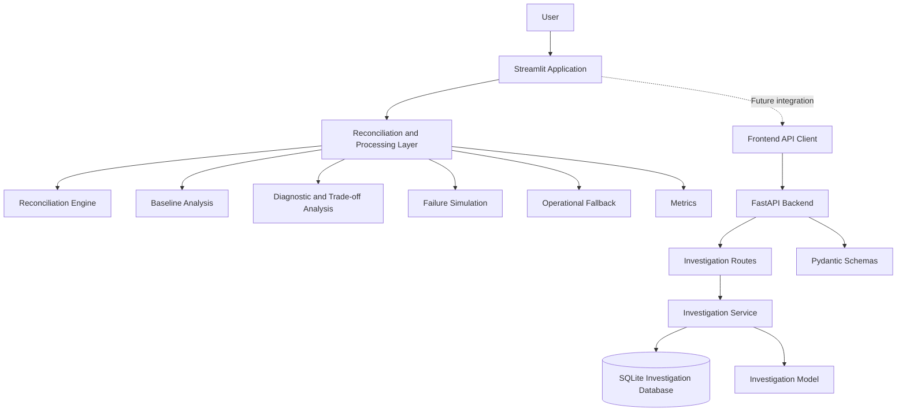

# SpareSync - System Architecture

## 1. Introduction

SpareSync is an Inventory Transaction Reconciliation and Investigation Management system designed to identify inventory discrepancies, analyze possible root causes, and support investigation workflows.

The system consists of a Streamlit-based application, a reconciliation processing layer, a FastAPI backend, and SQLite databases.

The architecture separates inventory analysis, API operations, and persistent investigation storage into individual components.

## 2. High-Level Architecture

The system follows a modular architecture with the following major layers:

1. Presentation Layer
2. Reconciliation and Processing Layer
3. API Layer
4. Service Layer
5. Database Layer

### Architecture Diagram



The dotted connection represents the planned integration between the Streamlit application and the API client. It should not be interpreted as a completed connection.

## 3. Presentation Layer

The presentation layer is implemented using Streamlit.

It provides the user interface for inventory reconciliation, diagnostic analysis, investigation workflows, data quality checks, scenario planning, and operational evaluation.

The application provides the following major sections:

- Dashboard
- Reconciliation
- Advanced Diagnostics
- Investigation Workbench
- Data Quality and Audit
- Scenario Planner
- Transaction Explorer
- Failure Simulation
- Operational Fallback
- Baseline Comparison
- Review 2 Evaluation

The existing Streamlit application is maintained through the root `app.py` file.

## 4. Reconciliation and Processing Layer

The processing layer contains the core inventory analysis modules.

These modules are maintained inside the `src/` directory.

| Module | Responsibility |
|---|---|
| `reconciliation_engine.py` | Processes inventory transactions and identifies discrepancies. |
| `baseline.py` | Calculates baseline stock and inventory variance. |
| `tradeoffs.py` | Supports comparison of operational decisions using different criteria. |
| `metrics.py` | Calculates performance and evaluation metrics. |
| `failure_simulator.py` | Simulates operational failures and their effects. |
| `fallback_handler.py` | Manages offline transactions and synchronization. |
| `data_generator.py` | Generates transaction data for system evaluation. |

The processing layer supports the Streamlit application by providing inventory analysis and operational decision-support functionality.

## 5. API Layer

The backend is developed using FastAPI.

The main application entry point is:

`backend/main.py`

It performs the following responsibilities:

- Creates the FastAPI application.
- Configures application metadata.
- Initializes the database during application startup using a lifespan handler.
- Registers the investigation router.
- Exposes a root endpoint and a health-check endpoint.

### API Endpoints

| Method | Endpoint | Purpose |
|---|---|---|
| GET | `/` | Returns API welcome information. |
| GET | `/health` | Checks API health. |
| POST | `/investigations/` | Creates an investigation. |
| GET | `/investigations/` | Retrieves all investigations. |
| GET | `/investigations/{investigation_id}` | Retrieves a specific investigation. |
| PUT | `/investigations/{investigation_id}` | Updates an investigation. |
| DELETE | `/investigations/{investigation_id}` | Deletes an investigation. |

FastAPI also provides interactive API documentation through `/docs`.

## 6. Service Layer

The service layer is implemented in:

`backend/services/investigation_service.py`

It contains the business logic for investigation management.

The service layer provides the following operations:

### Create Investigation

- Generates a unique investigation ID.
- Records the investigation details.
- Sets the initial status to `OPEN`.
- Generates creation and update timestamps.
- Stores the record in SQLite.

### Retrieve Investigation

- Retrieves an investigation using its unique ID.
- Returns `None` when the requested record does not exist.

### Retrieve All Investigations

- Retrieves all stored investigations.
- Orders the results by creation time, newest first.

### Update Investigation

- Updates permitted investigation fields.
- Refreshes the `updated_at` timestamp.
- Returns the updated investigation.
- Returns `None` if the investigation does not exist.

### Delete Investigation

- Deletes an investigation using its unique ID.
- Returns whether a record was successfully deleted.

Database operations use parameterized SQL queries for data values.

## 7. Data Validation Layer

Pydantic schemas are maintained in:

`backend/schemas.py`

They validate incoming API request data and define response structures.

The main schemas are:

- `InvestigationCreate`
- `InvestigationUpdate`
- `InvestigationResponse`

Validation includes:

- Required part and location information.
- Non-negative inventory quantities.
- Confidence values between 0 and 1.
- Supported investigation status values.
- Automatic calculation of inventory variance during investigation creation.

The variance is calculated as:

`Variance = System Stock - Physical Stock`

## 8. Database Layer

SQLite is used for persistent investigation storage.

Database implementation is maintained in:

`backend/database.py`

The database file is:

`data/sparesync.db`

The primary table is:

`investigations`

It stores:

- Investigation ID
- Part details
- Location
- System and physical stock
- Inventory variance
- Root cause
- Recommended action
- Confidence
- Investigation status
- Notes
- Creation and update timestamps

The database module manages connection creation, transaction commit and rollback, connection closure, and table initialization.

A separate `data/offline_queue.db` is used by the operational fallback mechanism to store pending offline transactions.

The investigation database and offline transaction queue serve different purposes.

## 9. Investigation Model

The investigation data model is maintained in:

`backend/models.py`

The `Investigation` dataclass represents an investigation record.

Its `from_row()` method converts a SQLite database row into an `Investigation` object.

This separates database row handling from the service logic.

## 10. Frontend API Client

The API client is maintained in:

`frontend/api_client.py`

It uses the `httpx` library to communicate with the FastAPI backend.

Its responsibilities include:

- Checking API health.
- Retrieving investigation records.
- Creating investigations.
- Updating investigations.
- Deleting investigations.
- Handling HTTP errors and connection failures through `APIClientError`.

The API client provides the communication interface intended for the Streamlit application.

Final integration with the main Streamlit application is a remaining development task.

## 11. Testing Architecture

The project uses `pytest` for automated testing.

The test suite covers:

- Inventory reconciliation.
- Baseline calculations.
- Trade-off analysis.
- Metrics.
- Failure simulation.
- Offline fallback.
- Database operations.
- API endpoints.
- Frontend API client behavior.

Database tests use temporary database files to avoid modifying the actual project database during testing.

## 12. Project Directory Structure

```text
COE Project/
│
├── app.py
│
├── backend/
│   ├── __init__.py
│   ├── main.py
│   ├── database.py
│   ├── models.py
│   ├── schemas.py
│   │
│   ├── routes/
│   │   ├── __init__.py
│   │   └── investigations.py
│   │
│   └── services/
│       ├── __init__.py
│       └── investigation_service.py
│
├── frontend/
│   └── api_client.py
│
├── src/
│   ├── reconciliation_engine.py
│   ├── baseline.py
│   ├── tradeoffs.py
│   ├── metrics.py
│   ├── failure_simulator.py
│   ├── fallback_handler.py
│   └── data_generator.py
│
├── tests/
│   ├── test_api.py
│   ├── test_database.py
│   ├── test_api_client.py
│   └── other test modules
│
├── data/
│   ├── transactions.csv
│   ├── physical_counts.csv
│   ├── offline_queue.db
│   └── sparesync.db
│
├── docs/
│   ├── architecture.md
│   ├── api_documentation.md
│   ├── database_schema.md
│   ├── testing_strategy.md
│   └── evaluation_report.md
│
├── requirements.txt
├── pytest.ini
├── README.md
└── .gitignore
```

## 13. Design Principles

The architecture follows these principles:

1. **Modularity:** Different responsibilities are maintained in separate modules.
2. **Separation of Concerns:** API routing, business logic, validation, and database operations are separated.
3. **Maintainability:** Individual components can be modified and tested independently.
4. **Reliability:** Database transactions support commit and rollback behavior.
5. **Data Validation:** Pydantic schemas validate API inputs.
6. **Testability:** Automated tests verify individual modules and API behavior.
7. **Extensibility:** The FastAPI backend provides a foundation for future frontend integration.

## 14. Future Improvements

The following improvements are planned:

- Complete integration of the Streamlit frontend with the FastAPI backend.
- Use persistent investigation records in the Investigation Workbench.
- Improve centralized error handling.
- Add authentication and authorization.
- Expand automated test coverage.
- Perform API performance and load testing.

## 15. Conclusion

SpareSync uses a modular architecture that separates inventory reconciliation, operational analysis, investigation management, and persistent storage.

The FastAPI backend and SQLite investigation database establish a foundation for persistent investigation management, while the existing Streamlit application continues to provide the inventory analysis interface.

The planned frontend integration will connect these components into a unified application.
```
